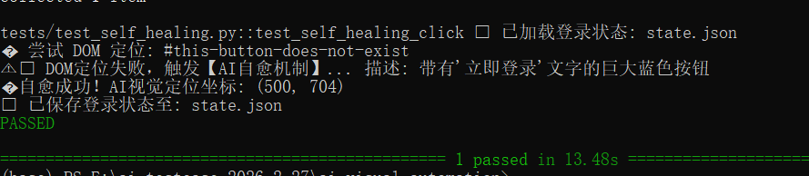

# 🤖 AI Visual Automation 视觉自愈自动化测试框架

基于 Playwright + 视觉识别 + 熔断风控 + 元素缓存 的 UI 自动化自愈框架，配套 Streamlit 可视化后台。解决传统自动化 DOM 定位脆弱、页面改版后脚本大面积失效的痛点。

## ✨ 核心特性

1. 自然语言指令编排自动化用例，参考 MCP 思想设计，测试人员低门槛上手
2. 优先 DOM 定位，定位失败自动触发视觉自愈分支，降低大模型调用开销
3. 多模式视觉 Agent：Mock 演示模式 / 预录制 JSON 模式 / Ollama 多模态模型
4. 自愈风控：元素缓存、时间窗口熔断、置信度校验、重试退避机制
5. 可视化管理后台：用例库管理、配置面板、实时日志、指标看板、趋势图
6. 用例 AI 评审（开发中）：上传需求文档自动评审、生成测试点
7. 报告输出：Markdown 在线预览下载、Allure 测试报告支持
8. 截图归档、图像对比能力

## 📁 项目目录说明

```
ai_visual_automation/
├── assets/
│   ├── templates/
│   ├── element_repair.yaml
│   └── self_healing_success.png
├── tests/                   # pytest自愈验证用例
│   ├── test_healing_cache_hit.py
│   ├── test_healing_circuit.py
│   ├── test_healing_demo.py
│   └── test_healing_mutate.py
├── tools/                   # 辅助工具脚本
│   ├── clear_heal_cache.py  # 清空自愈缓存
│   └── parse_healing_log.py # 日志解析、指标统计
├── vision/
│   └── vision_agent.py      # 视觉Agent抽象与多模式实现
├── app.py                   # Streamlit可视化后台入口
├── conftest.py              # pytest全局fixture、失败截图钩子
├── file_parser.py           # 文档解析工具
├── healing_logs.json        # 自愈日志持久化存储
├── mcp_agent.py             # 自然语言指令解析Agent
├── review_agent.py          # AI用例评审Agent（开发中）
├── test_form.html           # 本地演示被测页面
├── test_page.html           # 本地演示被测页面
├── .env.example             # 环境变量模板
├── .gitignore
├── README.md
├── INSTALL.md
├── ARCH.md
├── CHANGELOG.md
└── requirements.txt

```

## 🧩 技术栈

- Python 3.10+
- Playwright：浏览器自动化驱动
- Streamlit：Web 可视化后台
- Ollama / 多模态大模型：视觉识别、用例评审
- PyYAML：配置中心
- Pandas + Plotly：指标可视化看板
- Pytest：底层测试执行
- Allure：测试报告

## 🚀 快速启动

```
# 1. 安装依赖
pip install -r requirements.txt
# 2. 安装浏览器驱动
playwright install chromium
# 3. 复制环境变量，按需修改配置
cp .env.example .env
# 4. 启动可视化后台
streamlit run app.py
# 5. 底层自愈demo单独执行
pytest tests/test_healing_demo.py -v
```

## 🎬 功能演示流程

1. 系统配置页：切换视觉 Agent 模式、调整置信度、重试次数、熔断阈值
2. 用例 AI 评审：上传需求文档，AI 自动评审、输出测试点（开发中能力演示）
3. 自愈自动化：新建 / 选择自然语言编排脚本，发起浏览器自动化执行
4. 自愈执行：优先 DOM 定位，定位失败自动切换视觉识别；识别成功写入元素缓存；连续识别失败触发熔断保护
5. 首页看板：查看自愈指标、执行成功率、重试次数、趋势折线图
6. 报告中心：查看历史运行记录、预览下载 Markdown 报告、跳转 Allure 报告

## 📌 核心执行流程

```
读取用例 → 尝试CSS/XPath DOM定位
    ↓（定位成功）执行页面动作
    ↓（定位失败）页面截图 → 调用视觉Agent识别元素
    ↓识别成功 → 写入坐标缓存 → 执行动作
    ↓（多次识别失败）触发熔断，终止任务，输出失败日志
```

## 📸 演示截图

- DOM变异自愈成功日志


> 后续继续补充：Streamlit后台看板、自愈实时日志、Allure报告截图，图片直接放在assets目录下，新增图片后按下面格式添加引用
>
> 示例：
> - Streamlit后台首页看板
> 
>
> - 自愈执行实时日志
> 
>
> - Allure测试报告页面
> 

## 📄 版本说明

- 当前版本：v1.0.0
- 核心已完成：自愈引擎、多视觉 Agent、缓存熔断、Streamlit 后台、Allure 报告
- 开发中：AI 用例评审、批量任务调度、图像对比

## 📄 License

MIT
